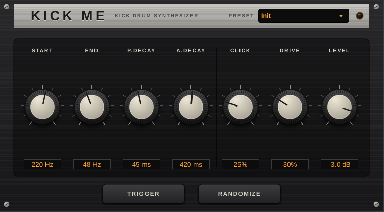

# Kick Me

A kick drum synth with an analog-style panel (VST3, AU and Standalone), built with JUCE 8.

Play any MIDI note to trigger a kick (velocity sets the hit level). TRIGGER plays a hit, RANDOMIZE rolls a new kick and plays it.

Parameters: Start Pitch, End Pitch, Pitch Decay, Amp Decay, Click, Drive, Level.

Presets (PRESET menu, or Live's program list): Init, 808, Trap 808, Techno, House, Hardstyle, Drum & Bass, Boom Bap, Psytrance, Lo-fi.

## Download (macOS)

**[Download KickMe.dmg](https://github.com/noisyloop/kick-me/releases/latest/download/KickMe.dmg)** (Apple Silicon + Intel, macOS 12+)

Open the DMG, quit Ableton Live and double-click `Install-KickMe.command`, then press Return.
It installs to your user account in one step and clears the download quarantine
(the build is ad-hoc signed and not notarized, so Live won't load it otherwise):
VST3 to `~/Library/Audio/Plug-Ins/VST3/KickMe.vst3`, AU to
`~/Library/Audio/Plug-Ins/Components/`, and the standalone app to `~/Applications/`.

If macOS blocks the installer itself, paste this into Terminal instead, with the DMG open. It does the same for the VST3 in one command:

    V=~/Library/Audio/Plug-Ins/VST3; mkdir -p "$V" && rm -rf "$V/KickMe.vst3" "$V/InfinatiKick.vst3" "$V/Infinati Kick.vst3" && ditto /Volumes/KickMe/KickMe.vst3 "$V/KickMe.vst3" && xattr -cr "$V/KickMe.vst3" && echo "Kick Me installed"

Both remove older `InfinatiKick.vst3` / `Infinati Kick.vst3` bundles (the plugin's earlier name) so Live doesn't list it twice. The plugin IDs are unchanged, so Live sets saved with Infinati Kick should open with Kick Me in its place. Then rescan in Live (see below).

On Windows, build from source (below) and copy the `.vst3` folder to `C:\Program Files\Common Files\VST3\`.

## Build (Mac)

Prerequisites: full Xcode with its command line tools selected, and CMake (`brew install cmake`).

    cmake -S . -B build -G Xcode -DCMAKE_OSX_DEPLOYMENT_TARGET=12.0 -DCMAKE_OSX_ARCHITECTURES="arm64;x86_64"
    cmake --build build --config Release

Build products (`KickMe.vst3`, `KickMe.component`, `KickMe.app`) are in `build/KickMe_artefacts/Release/`.
Automatic installation is disabled by default; opt in with `-DKICKME_COPY_PLUGIN=ON`.

## Build (Windows)

Prerequisites: Visual Studio 2022 (Desktop development with C++), CMake.

    cmake -B build
    cmake --build build --config Release

Copy the `.vst3` folder from `build\KickMe_artefacts\Release\VST3\` to
`C:\Program Files\Common Files\VST3\`.

The first configure downloads JUCE from GitHub, so it takes a few minutes.

## Tests

    ctest --test-dir build -C Release --output-on-failure

`Tests/RenderTests.cpp` renders the processor offline and checks silence without MIDI, hit level and decay,
velocity response, click-free retriggering, stability at extreme settings, state save/restore, value text, randomize and every preset.
CI also runs [pluginval](https://github.com/Tracktion/pluginval) at strictness 10 on every format and `auval` on the AU.

## Ableton Live

Preferences > Plug-Ins > turn on "Use VST3 Plug-In System Folders" (and "Use Audio Units" on Mac), then
press Rescan. Create a MIDI track, load "Kick Me" from Plug-Ins > Instruments.
